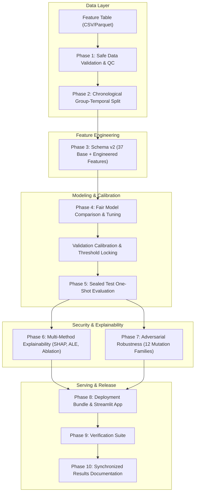

# Malicious PDF Detector — Project Guide & Roadmap

Welcome to the **Malicious PDF Detector** project repository. This guide provides an executive overview of the project, links to all key presentation and academic deliverables, outlines the 10-phase architecture, and explains how to run the system with one-click scripts or CLI commands.

---

## 1. Executive Summary

This project implements a **leakage-resistant, reproducible, and explainable malicious PDF detection system** built to satisfy rigorous scientific and defense-in-depth criteria:

- **Realistic Base Rate & Natural Prevalence:** Evaluated under real-world operational distributions ($\ge 99.5\%$ benign, $\le 0.5\%$ malicious) with zero synthetic oversampling (no SMOTE) or random row-leakage splitting.
- **Safe Feature-Only Pipeline:** Training accepts only checksummed, approved tabular feature data. No live malware binaries, raw executable payloads, or weaponized scripts are downloaded, unpacked, or stored.
- **Fail-Closed 3-Way Decisions:** Instead of forcing binary predictions on corrupt or unknown inputs, the model outputs `benign`, `malicious`, or `uncertain/abstain` when inputs exceed out-of-distribution (OOD) boundaries, exceed resource quotas, or fail parsing.
- **Multi-Model Benchmark:** Fairly compares linear models, Extra Trees, Random Forests, LightGBM, XGBoost, PyTorch MLP, and FT-Transformer under identical cross-validation folds and locked validation thresholds.
- **Sealed Test Set Integrity:** The test set is claimed atomically once per experiment identity, preventing data snooping or threshold tuning on test metrics.

---

## 2. Key Deliverables & Quick Links

All primary presentation assets, reports, code modules, and apps are organized as follows:

| Deliverable | Location | Description |
|---|---|---|
| **Final Presentation Deck** | [`output/presentation/malicious_pdf_detector_final_presentation.pptx`](../output/presentation/malicious_pdf_detector_final_presentation.pptx) | Complete PowerPoint slide deck formatted for final academic and technical defense. |
| **Speaker Guide (English)** | [`output/pdf/malicious_pdf_detector_speaker_guide.pdf`](../output/pdf/malicious_pdf_detector_speaker_guide.pdf) | Slide-by-slide speaker notes, talking points, and Q&A preparation. |
| **Speaker Guide (Arabic)** | [`output/pdf/malicious_pdf_detector_speaker_guide_ar.pdf`](../output/pdf/malicious_pdf_detector_speaker_guide_ar.pdf) | Arabic translation of speaker notes and defense talking points. |
| **Technical Report (LaTeX)** | [`report/main.tex`](../report/main.tex) | Full IEEE/academic paper draft detailing theory, methodology, and results. |
| **Interactive Scanner Web App** | [`app/streamlit_app.py`](../app/streamlit_app.py) | Local Streamlit web dashboard for real-time PDF scanning, probability gauges, radar charts, and LLM analysis. |
| **Model Comparison Table** | [`reports/archive/author_verified_pre_remediation/model_comparison.csv`](../reports/archive/author_verified_pre_remediation/model_comparison.csv) | Empirical benchmark comparing MLP, LightGBM, Random Forest, and XGBoost. |
| **Detailed Plan & Audit** | [`professor_feedback_remediation_plan.md`](professor_feedback_remediation_plan.md) | Exhaustive remediation plan addressing academic feedback across 10 phases. |

---

## 3. Quick Start & One-Click Launchers (Windows)

To make running and evaluating the project effortless on Windows, three launcher scripts are included in the repository root:

### 1. One-Click Environment Setup (`setup.bat`)
Double-click `setup.bat` or run:
```cmd
setup.bat
```
- Checks Python 3.11+ availability.
- Automatically creates a clean `.venv` virtual environment.
- Upgrades `pip` and installs all packages from `requirements.txt`.

### 2. One-Click Interactive Scanner (`run_scanner.bat`)
Double-click `run_scanner.bat` or run:
```cmd
run_scanner.bat
```
- Activates the virtual environment.
- Automatically builds the validated local deployment bundle (`deployment_bundle_v1.joblib`) from the verified mirror if not already built.
- Launches the Streamlit Web Application at `http://localhost:8501`.

### 3. One-Click Test Suite (`run_tests.bat`)
Double-click `run_tests.bat` or run:
```cmd
run_tests.bat
```
- Runs the full `pytest` verification suite covering schema validation, anti-leakage gates, live parity, and adversarial resistance.

---

## 4. End-to-End Pipeline & Phase Map



### Phase Summary Table

| Phase | Title | Key Implementation Details |
|---|---|---|
| **0** | **Experiment Identity** | SHA-256 fingerprinting of config, code commit, dataset, and random seed. Sidecar validation. |
| **1** | **Safe Validated Data** | Streaming batch scanning with PyArrow; strict type and bounds enforcement; two-pass SQLite deduplication and label-conflict removal. |
| **2** | **Group-Temporal Split** | Chronological ordering (Train $\rightarrow$ Val $\rightarrow$ Test); zero group/sample overlap; preserves $\ge 99.5\%$ natural benign prevalence. |
| **3** | **Feature Pipeline v2** | 37 canonical base features (structural elements, actions, streams) + density, entropy, and gap metrics; live safe extraction. |
| **4** | **Fair Model Comparison** | Evaluates Baselines, Logistic Regression, Extra Trees, Random Forest, LightGBM, XGBoost, PyTorch MLP, and FT-Transformer. |
| **5** | **Locked Metrics** | Sealed test set opened exactly once; reports Precision, Recall, F0.5/F1/F2, PR-AUC, partial ROC at 0.1% FPR, ECE, and false positives per million. |
| **6** | **Deep Explainability** | Multi-method evidence combining background-sampled SHAP, permutation importance, retrained ablation, ALE interactions, and counterfactuals. |
| **7** | **Adversarial Robustness** | 12 inert PDF structural mutation families (metadata padding, stream encryption, xref evasion) measuring post-defense abstention. |
| **8** | **Deployment Bundle** | Unified `deployment_bundle_v1.joblib` combining pipeline, model, locked threshold, and OOD bounds for the Streamlit UI. |
| **9** | **Stage Verification** | Manifest chain verification, non-retention checks, and regression tests. |
| **10** | **Synchronized Docs** | Dynamic generation of report sections, tables, and metric summaries from verified artifacts. |

---

## 5. Repository Directory Map

```text
Malicious-PDF-detector/
├── app/                        # Streamlit web application & UI components
│   ├── assets/                 # Custom styling (style.css)
│   ├── components/             # UI widgets: analyzer, gauge, radar, LLM chat, uploader
│   └── streamlit_app.py        # Main application entry point
├── configs/                    # Declarative configurations
│   ├── data_sources.yaml       # Approved feature table sources & verification checksums
│   └── experiment.yaml         # Master experiment hyperparameters & acceptance gates
├── data/                       # Data storage & mirrors
│   ├── external/               # Downloaded tables and source manifests
│   ├── sample_pdfs/            # Safe inert sample PDFs (benign and synthetic malicious)
│   └── sample_reports/         # Pre-computed scan reports in JSON and Markdown
├── docs/                       # Comprehensive technical documentation
│   ├── adversarial_robustness.md
│   ├── conclusions.md
│   ├── dataset_card.md
│   ├── explainability.md
│   ├── metrics_and_thresholds.md
│   └── model_card.md
├── notebooks/                  # Interactive exploratory and demonstration notebooks (01 to 07)
├── output/                     # Final presentation and defense materials
│   ├── pdf/                    # Speaker notes in English & Arabic
│   └── presentation/           # PowerPoint defense slide deck (.pptx)
├── report/                     # Academic LaTeX paper draft
│   ├── main.tex                # Master LaTeX paper
│   ├── references.bib          # Bibliography
│   └── generated_results.tex   # Artifact-synchronized results table
├── reports/                    # Manifests, benchmark results, and archived runs
│   ├── archive/                # Checksummed pre-remediation historical runs
│   └── results/                # Active experiment summaries and model comparisons
├── scripts/                    # Utility automation scripts
│   ├── build_validated_bundle.py  # Builds the local deployment bundle
│   ├── sync_results_docs.py       # Synchronizes results into LaTeX and Markdown
│   └── generate_sample_reports.py # Pre-computes sample scan reports
├── src/                        # Core Python package
│   ├── data/                   # Batch validation, deduplication, splitting, manifests
│   ├── features/               # Schema v2, extraction, canonicalization, pipeline
│   ├── llm/                    # Local LLM explanation & report generation (Ollama)
│   ├── models/                 # Model registry, training, calibration, metrics, evaluation
│   ├── optimization/           # Model quantization & performance benchmarking
│   ├── security/               # Adversarial mutations & file envelope checks
│   ├── utils/                  # Atomic I/O, logging, visualization
│   ├── inference.py            # Local PDF inference & 3-way decision logic
│   └── run_all.py              # Unified CLI runner for all pipeline stages
├── tests/                      # Extensive pytest test suite
├── PROJECT_GUIDE.md            # This comprehensive project roadmap & guide
├── README.md                   # Primary repository readme
├── requirements.txt            # Python dependencies
├── setup.bat                   # 1-click Windows environment installer
├── run_scanner.bat             # 1-click Windows Streamlit launcher
└── run_tests.bat               # 1-click Windows pytest runner
```

---

## 6. Command-Line Reference

If running via CLI instead of the batch scripts, activate your virtual environment and run:

### Build Local Bundle:
```bash
python scripts/build_validated_bundle.py
```

### Launch Streamlit Scanner:
```bash
python -m streamlit run app/streamlit_app.py
```

### Run Stage-by-Stage Pipeline:
```bash
# Initialize experiment identity
python -m src.run_all init --config configs/experiment.yaml

# Validate data quality & quarantine invalid rows
python -m src.run_all validate-data --config configs/experiment.yaml

# Create chronological group-temporal split
python -m src.run_all split --config configs/experiment.yaml

# Engineer Schema v2 features
python -m src.run_all build-features --config configs/experiment.yaml

# Train candidate models & lock validation thresholds
python -m src.run_all train --config configs/experiment.yaml

# One-shot sealed test evaluation (requires confirmation flag)
python -m src.run_all evaluate --config configs/experiment.yaml --confirm-sealed-test-evaluation
```

### Run Verification Suite:
```bash
pytest -q
```
